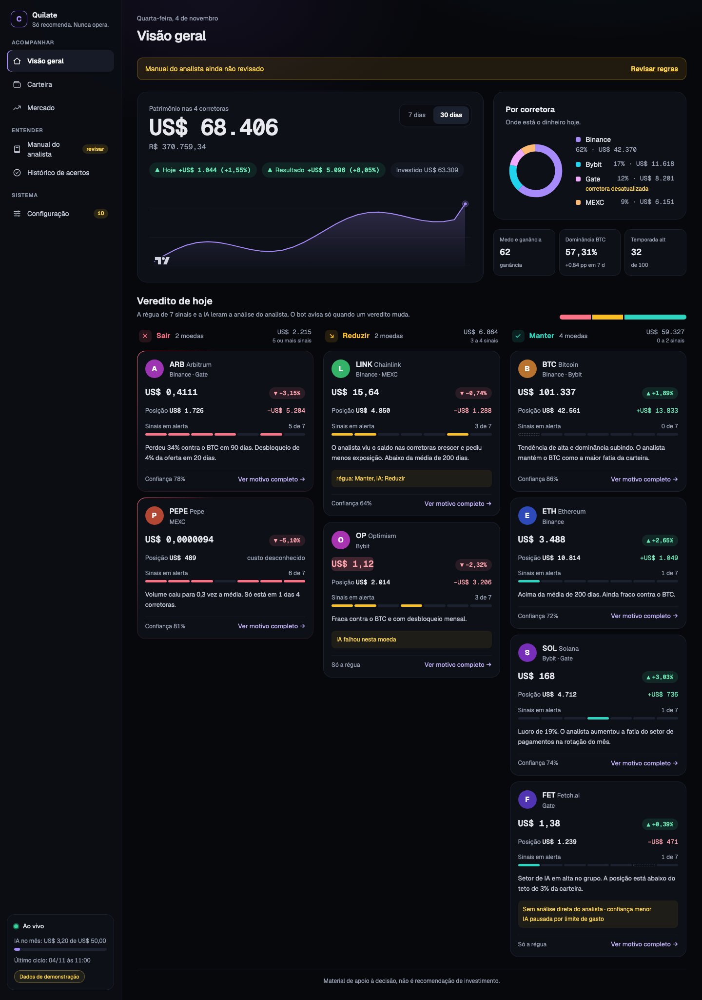
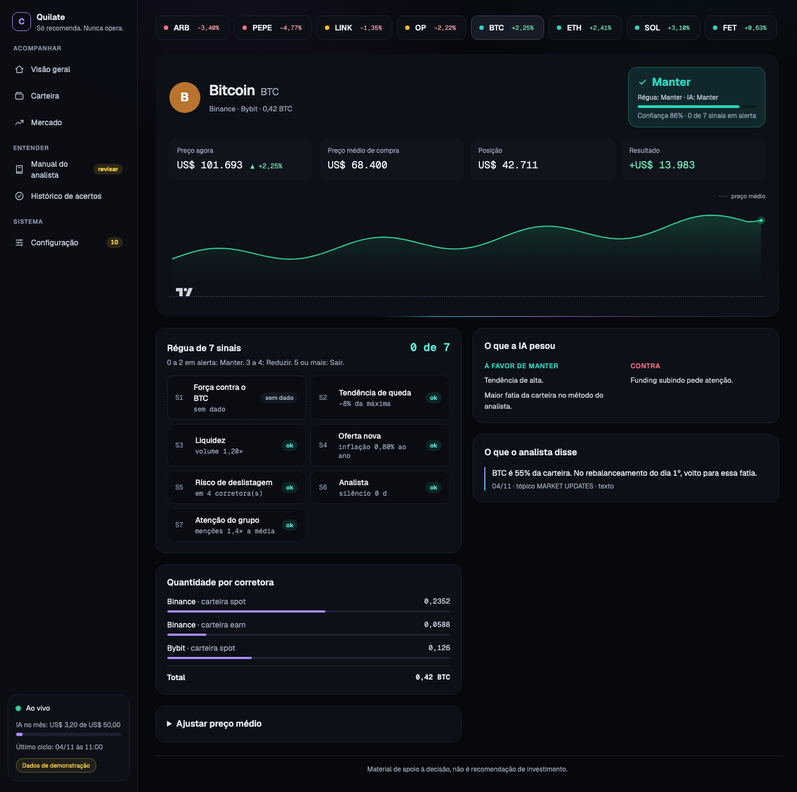
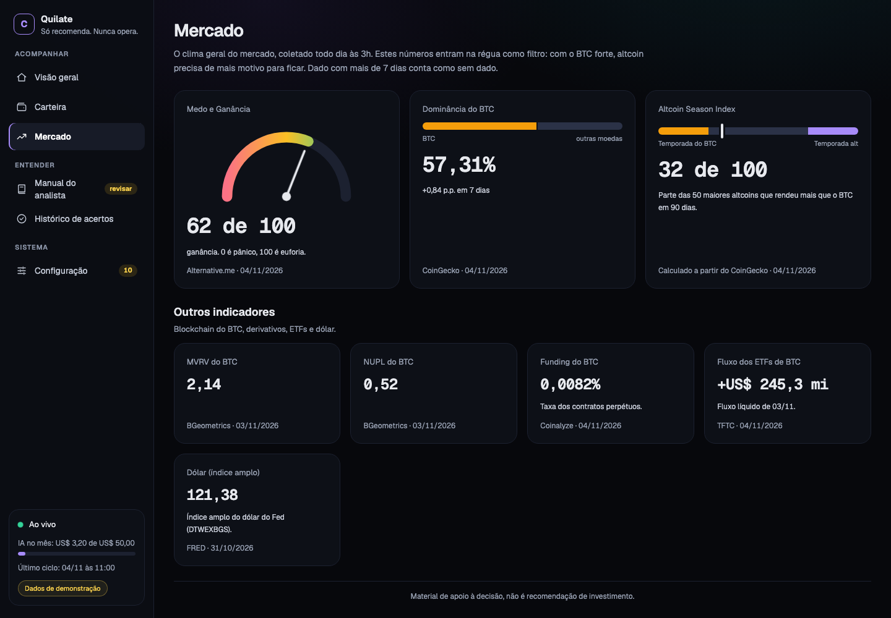
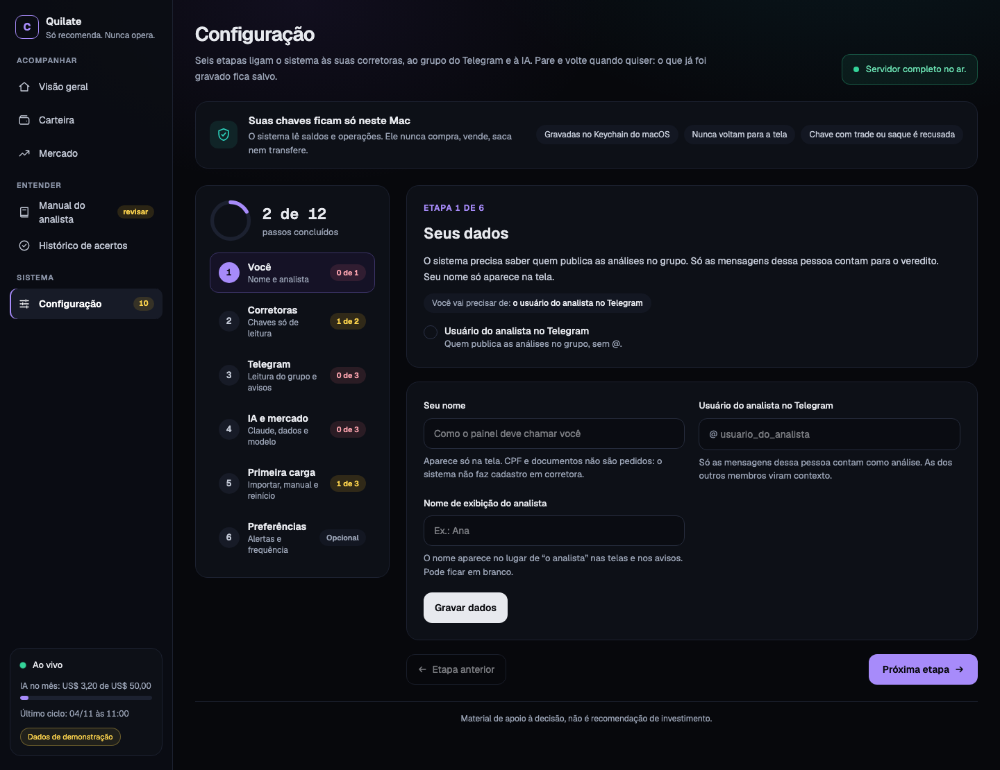
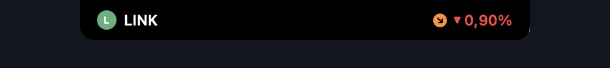
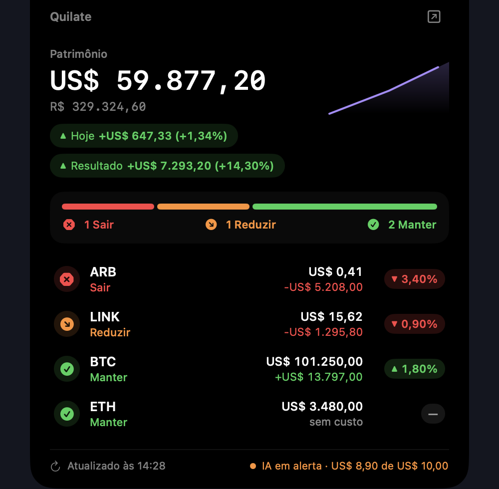
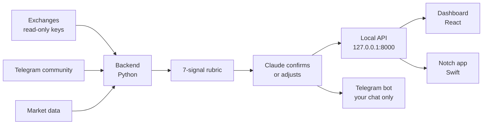

# Quilate

[Português](README.pt-BR.md)

Quilate watches your crypto portfolio on four exchanges, reads an analyst's Telegram community, and gives each coin a daily verdict: hold, reduce or exit. It runs only on your Mac, it only reads, and it never trades.

> Quilate is a decision aid. It is not investment advice. Read [the disclaimer](#disclaimer).

## Screenshots

All screenshots use the built-in demo data. No real portfolio was harmed.

| Overview | Coin |
|---|---|
|  |  |
| **Market** | **Setup** |
|  |  |

The notch app shows the same verdicts in the MacBook notch:

| Closed | Open |
|---|---|
|  |  |

The dashboard interface is in Portuguese for now. Translation is on the [roadmap](docs/roadmap.md).

## How it works



1. **Portfolio.** Every 5 minutes the backend reads balances and trades from Binance, MEXC, Bybit and Gate, with read-only keys. The average cost comes from trades, exchange CSV exports and manual fixes.
2. **Community.** It reads the Telegram group with your account, read-only. The analyst's audio and videos are transcribed on your Mac. Everything goes into SQLite, with keyword and meaning search.
3. **Market.** At 3:00 it stores a market snapshot: BTC dominance, alt season, funding, Fear and Greed, ETF flows and more.
4. **Verdict.** A rubric of [7 signals](docs/signals.md) gives a base verdict. Claude reads the analyst's playbook, the day's quotes and the group's mood, then confirms or adjusts it, with reasons and a confidence. The cycle runs when the analyst posts the daily analysis, or at noon.
5. **Follow-up.** Quilate measures each verdict after 7, 30 and 90 days, against holding and against BTC. A Telegram bot sends you a daily summary and a message when a verdict changes. AI spending has a monthly limit.

More in [docs/architecture.md](docs/architecture.md).

## Try it in two minutes

You need Node 22.12 or newer. No backend, no keys, no Telegram.

```sh
git clone https://github.com/trivixlabs/quilate
cd quilate/frontend
npm ci
npm run dev
```

Open <http://127.0.0.1:5173/?demo=1>. Every page works with fake data, and a "Dados de demonstração" label shows in the sidebar. Demo mode works only on the dev server.

To see the notch app with fake data, you need a Mac with Swift 6. From the repository root, in one terminal:

```sh
cd notch
./demo.sh
```

In a second terminal:

```sh
cd notch
./build.sh && open Quilate.app
```

`demo.sh` serves the test fixtures on `127.0.0.1:8000`. Stop it with Ctrl-C.

## Full install

The full system needs a Mac with Apple Silicon, read-only exchange keys, a Telegram account, an Anthropic API key and a few free data keys. Follow [docs/install.md](docs/install.md). The settings are in [docs/configuration.md](docs/configuration.md).

## Project status

Be aware of what this is today:

- It runs only on macOS with Apple Silicon. Transcription uses `mlx-whisper`.
- It covers crypto only, on Binance, MEXC, Bybit and Gate.
- It was built for one portfolio and one community. Some checks still need real data: see [docs/verification.md](docs/verification.md).
- The dashboard, the CLI and the notch app are in Portuguese.
- The local API has no access code yet. See [SECURITY.md](SECURITY.md).
- The repository was just opened. Expect rough edges and fast changes.

## Roadmap

Stocks from B3 and the US, an MCP server, an access code for the local API, a demo mode in the backend, an English interface and a visual identity. Details in [docs/roadmap.md](docs/roadmap.md).

## Contributing

Issues and pull requests are welcome, in English or Portuguese. Start with [CONTRIBUTING.md](CONTRIBUTING.md). Look for issues labeled `good first issue`. Please follow the [Code of Conduct](CODE_OF_CONDUCT.md). Report security problems in private, as [SECURITY.md](SECURITY.md) explains.

Docs for contributors: [architecture](docs/architecture.md), [API](docs/api.md), [signals](docs/signals.md), [decisions](docs/decisions.md), [threat model](docs/threat-model.md). Rules for people and AI coding tools: [AGENTS.md](AGENTS.md).

## Origin

Quilate joins two projects. `carteira-cripto`, by Vitor Trigo, read the portfolio and the community and produced the verdicts. The idea of a portfolio ticker in the MacBook notch came from [StockNotch](https://github.com/rodrigovixc/macOs-notch-ticker), by Rodrigo da Vitoria. The name comes from the carat ("quilate" in Portuguese), the measure of gold purity: Quilate measures the quality of each asset.

## License

Quilate is free software under the [GNU AGPL-3.0 or later](LICENSE). Copyright and third-party notices are in [NOTICE](NOTICE) and [docs/third-party-licenses.md](docs/third-party-licenses.md).

## Disclaimer

Quilate is a decision aid. It is not investment advice, and it is not a recommendation to buy, sell or hold any asset. The verdicts come from a rubric and from an AI model, and both can be wrong. Crypto assets are volatile, and you can lose all the money you put in. You are responsible for your decisions.
