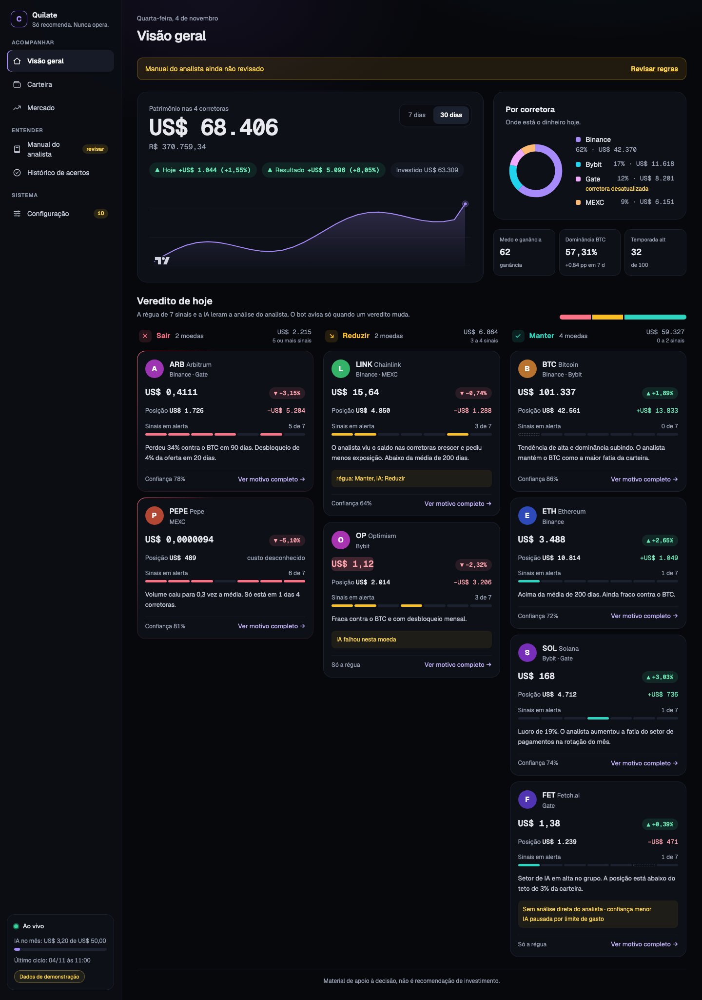
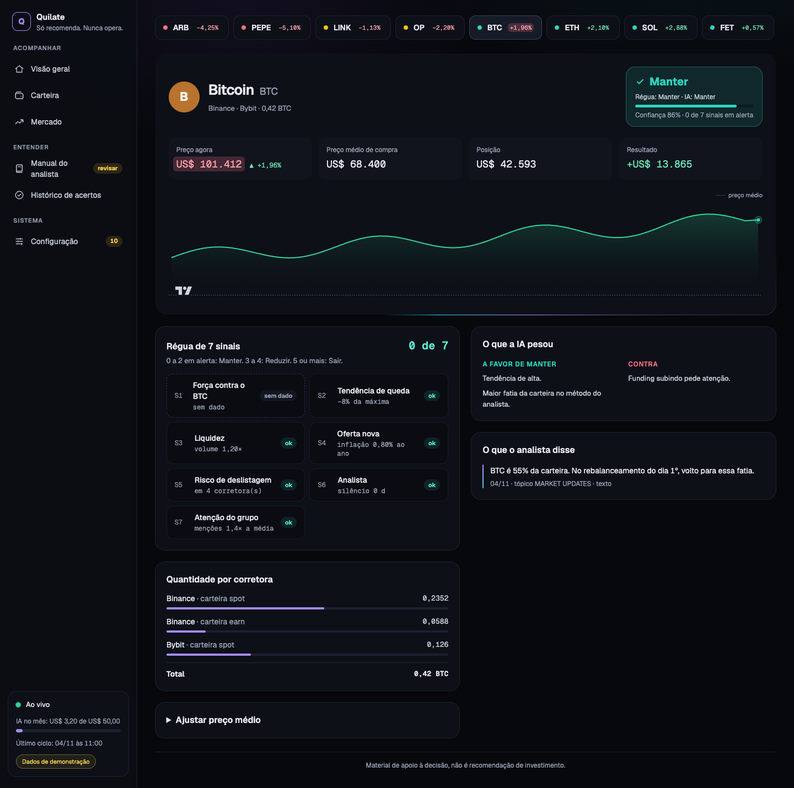
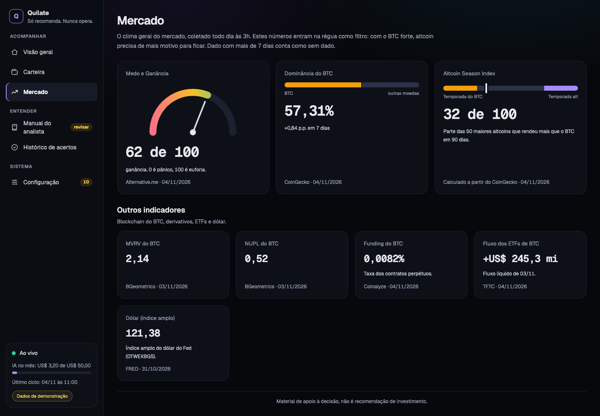
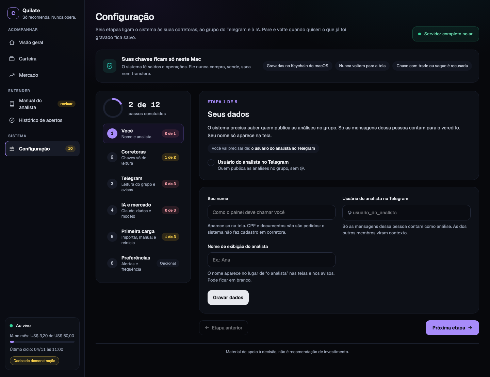
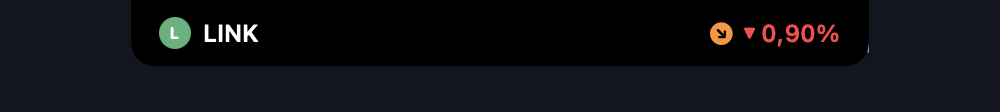
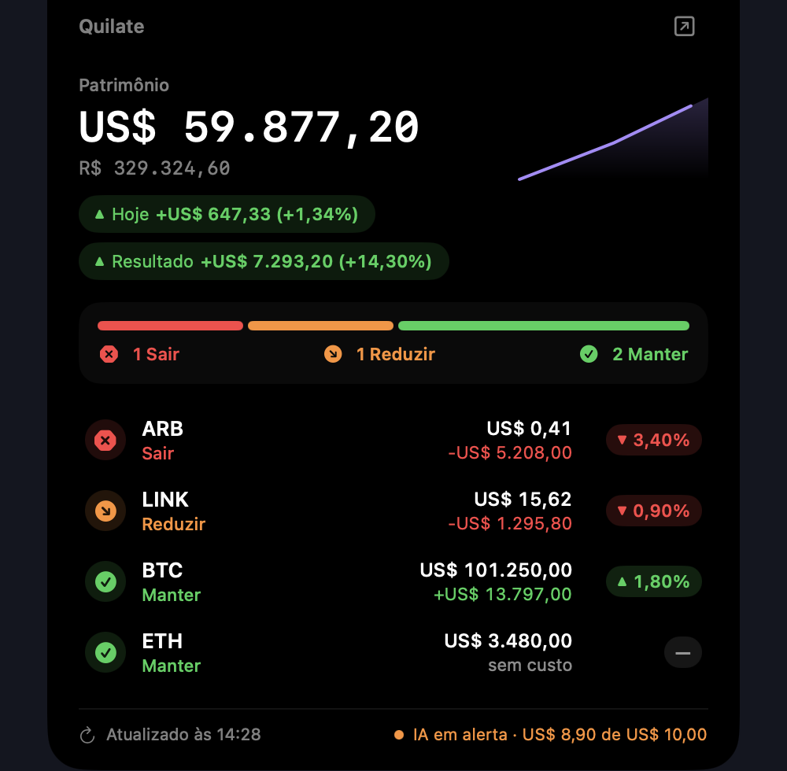
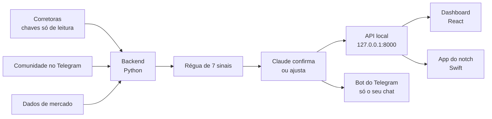

# Quilate

[](https://github.com/trivixlabs/quilate/actions/workflows/ci.yml)
[](LICENSE)

[](CONTRIBUTING.pt-BR.md)

[English](README.md)

O Quilate acompanha a sua carteira de cripto em quatro corretoras e lê a comunidade de um analista no Telegram. Todo dia, ele dá um veredito por moeda: Manter, Reduzir ou Sair. Ele roda só no seu Mac, só lê e nunca opera.

> O Quilate é material de apoio à decisão. Não é recomendação de investimento. Leia [o aviso](#aviso).

## Capturas de tela

Todas as capturas usam os dados fictícios do modo demonstração. Nenhuma carteira real passou vergonha nesta foto.

| Visão geral | Moeda |
|---|---|
|  |  |
| **Mercado** | **Configuração** |
|  |  |

O app do notch mostra os mesmos vereditos no notch do MacBook:

| Fechado | Aberto |
|---|---|
|  |  |

## Como funciona



1. **Carteira.** A cada 5 minutos o backend lê saldos e trades da Binance, MEXC, Bybit e Gate, com chaves somente leitura. O preço médio vem dos trades, do CSV exportado da corretora e de ajuste manual.
2. **Comunidade.** O sistema lê o grupo do Telegram com a sua conta, só leitura. Áudios e vídeos do analista são transcritos no próprio Mac. Tudo vai para um SQLite com busca por palavra e por significado.
3. **Mercado.** Às 3h o sistema grava um retrato do mercado: dominância do BTC, temporada de altcoins, funding, Medo e Ganância, fluxo de ETF e outros.
4. **Veredito.** Uma régua de [7 sinais](docs/signals.md) dá o veredito base. O Claude lê o manual do analista, as citações do dia e o humor do grupo. Depois confirma ou ajusta o veredito, com motivos e confiança. O ciclo roda quando o analista posta a análise do dia, ou ao meio-dia.
5. **Acompanhamento.** O Quilate mede cada veredito em 7, 30 e 90 dias, contra segurar a moeda e contra o BTC. Um bot do Telegram manda o resumo do dia e avisa quando um veredito muda. O gasto com IA tem limite mensal.

Mais detalhes em [docs/architecture.md](docs/architecture.md), em inglês.

## Teste em dois minutos

Você precisa do Node 22.12 ou mais novo. Sem backend, sem chave, sem Telegram. Mais fácil que explicar cripto no almoço de domingo.

```sh
git clone https://github.com/trivixlabs/quilate
cd quilate/frontend
npm ci
npm run dev
```

Abra <http://127.0.0.1:5173/?demo=1>. Todas as páginas funcionam com dados fictícios, e a etiqueta "Dados de demonstração" aparece na barra lateral. O modo demonstração só funciona no servidor de desenvolvimento.

Para ver o app do notch com dados fictícios, você precisa de um Mac com Swift 6. Na raiz do repositório, em um terminal:

```sh
cd notch
./demo.sh
```

Em um segundo terminal:

```sh
cd notch
./build.sh && open Quilate.app
```

O `demo.sh` serve os arquivos de teste em `127.0.0.1:8000`. Pare com Ctrl-C.

## Instalação completa

O sistema completo precisa de um Mac com Apple Silicon e de chaves somente leitura das corretoras. Também precisa de uma conta do Telegram, de uma chave da API da Anthropic e de algumas chaves gratuitas de dados. Siga [docs/install.md](docs/install.md). As configurações estão em [docs/configuration.md](docs/configuration.md). Os dois estão em inglês.

## Estado do projeto

Saiba o que o projeto é hoje:

- Roda só em macOS com Apple Silicon. A transcrição usa o `mlx-whisper`.
- Cobre só cripto, na Binance, MEXC, Bybit e Gate.
- Foi feito para uma carteira e uma comunidade. Algumas checagens ainda dependem de dados reais. Veja [docs/verification.md](docs/verification.md).
- O dashboard, a CLI e o app do notch estão em português.
- A API local ainda não tem código de acesso. Veja [SECURITY.md](SECURITY.md).
- O repositório acabou de abrir. Espere arestas e mudanças rápidas.

## Roteiro

Ações da B3 e dos EUA, servidor MCP, código de acesso na API local, modo demonstração no backend, interface em inglês e identidade visual. Detalhes em [docs/roadmap.md](docs/roadmap.md).

## Como contribuir

Issues e pull requests são bem-vindos, em português ou inglês. Comece pelo [CONTRIBUTING.pt-BR.md](CONTRIBUTING.pt-BR.md). Procure as issues com a etiqueta `good first issue`. Siga o [Código de Conduta](CODE_OF_CONDUCT.md). Relate falha de segurança em privado, como explica o [SECURITY.md](SECURITY.md).

Documentos para quem contribui, em inglês: [arquitetura](docs/architecture.md), [API](docs/api.md), [sinais](docs/signals.md), [decisões](docs/decisions.md), [modelo de ameaças](docs/threat-model.md). Regras para pessoas e ferramentas de IA: [AGENTS.md](AGENTS.md).

## Origem

O Quilate une dois projetos. O `carteira-cripto`, do Vitor Trigo, lia a carteira e a comunidade e gerava os vereditos. A ideia de mostrar a carteira no notch do MacBook veio do [StockNotch](https://github.com/rodrigovixc/macOs-notch-ticker), do Rodrigo da Vitoria. O nome vem do quilate, a medida de pureza do ouro: o Quilate mede a qualidade de cada ativo.

## Mantenedores

| | |
|---|---|
|  | **Vitor Trigo** ([@vitaomt](https://github.com/vitaomt)). Escreveu o `carteira-cripto`: o backend, os vereditos e o dashboard. |
|  | **Rodrigo da Vitoria** ([@rodrigovixc](https://github.com/rodrigovixc)). Escreveu o StockNotch, a ideia por trás do app do notch. |

O Quilate é um projeto da [Trivix Labs](https://github.com/trivixlabs). Quem tem commit no repositório aparece na [página de contribuidores](https://github.com/trivixlabs/quilate/graphs/contributors). O próximo pode ser o seu.

## Licença

O Quilate é software livre sob a [GNU AGPL-3.0 ou posterior](LICENSE). Direitos autorais e avisos de terceiros estão em [NOTICE](NOTICE) e [docs/third-party-licenses.md](docs/third-party-licenses.md).

## Aviso

O Quilate é material de apoio à decisão. Não é recomendação de investimento, nem indicação para comprar, vender ou manter qualquer ativo. Os vereditos vêm de uma régua e de um modelo de IA, e os dois podem errar. Criptoativos variam muito de preço, e você pode perder todo o dinheiro investido. A decisão é sua.
