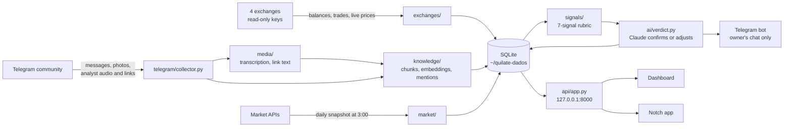

# Architecture

Quilate has three parts. All of them run on one Mac.

| Part | Folder | Language | Job |
|---|---|---|---|
| Backend | `backend/` | Python 3.12 | Reads the exchanges, the Telegram community and market data. Computes the verdicts. Serves the API on `127.0.0.1:8000`. |
| Dashboard | `frontend/` | React, TypeScript | The web page. The backend serves the built files from `backend/quilate/api/static`. |
| Notch app | `notch/` | Swift | A macOS app that shows the portfolio in the MacBook notch. It only reads three API routes. |

The backend is the only brain. The dashboard and the notch app never talk to an exchange, to Telegram or to the AI. They only call the local API.

## Data flow

1. **Portfolio.** Every `sync_minutes` (default 5), `exchanges/sync.py` reads balances and trades from Binance, MEXC, Bybit and Gate. The average cost comes from the trades, from CSV files exported by the exchange, and from manual overrides on the dashboard (`exchanges/cost_basis.py`). Live prices come from WebSocket on Binance, Bybit and Gate, and from 5-second polling on MEXC (`_poll_tickers` in `exchanges/client.py`). `exchanges/live.py` runs both.
2. **Community.** `telegram/collector.py` reads the group with the owner's Telegram account. It never sends anything to the group. Photos are downloaded. Audio is downloaded and queued for transcription only when the analyst sent it. Links in the analyst's messages are queued: YouTube videos are downloaded and transcribed, other pages have their text extracted (`media/`).
3. **Knowledge.** Every 30 minutes, `knowledge/` splits messages and transcripts into chunks, embeds them with EmbeddingGemma, and indexes them for keyword search (SQLite FTS5) and vector search (`sqlite-vec`). Search merges both with reciprocal rank fusion. Claude Haiku reads new messages and records which coin each one mentions, the analyst's stance, and the polarity of members' messages (`knowledge/mentions.py`).
4. **Market.** At 3:00 local time, `market/collect.py` stores one snapshot per source: BTC dominance, alt season index, Fear and Greed, funding, on-chain BTC data, ETF flows, stablecoin supply, the US dollar index, USD/BRL, daily candles and delisting flags.
5. **Verdict.** The daily cycle runs when the analyst posts in the trigger topic, or at `cutoff_hour` (default 12:00). For each coin, `signals/rubric.py` computes 7 signals and a base verdict (see [signals.md](signals.md)). Then `ai/verdict.py` sends the signals, the coin data, the market data, the analyst's playbook and the analyst's recent quotes to Claude Sonnet. Claude returns a verdict with reasons, quotes and a confidence. The final verdict is Claude's verdict, or the rubric's verdict when the AI is paused or fails.
6. **Follow-up.** `track/record.py` measures each verdict after 7, 30 and 90 days, against holding and against BTC. The bot sends the daily summary and a message when a verdict changes. It does not send a message for a price move that does not change the verdict.

Three events recompute a coin outside the daily cycle: a new message from the analyst that cites the coin (with Claude), a price move above `intraday_move` from yesterday's close (rubric only, once per day per coin), and a new Binance Monitoring Tag or a delisting (rubric only).

## The analyst's playbook

`ai/playbook.py` builds a playbook from the analyst's own messages and transcripts, with Claude Opus. The first version is a one-time job (`quilate manual-inicial`). It shows the estimated cost and asks for confirmation. Every Sunday at 20:00 the scheduler proposes an update from the last 7 days. Each rule stays pending until the owner approves it on the dashboard. Verdicts use only the approved version.

## Scheduler jobs

`scheduler.py` registers these jobs:

| Job | When | What |
|---|---|---|
| `sync_all` | every `sync_minutes` | exchange balances and trades |
| `ciclo_diario` | every 2 minutes | runs the daily cycle if it is due |
| `intradiario` | every `sync_minutes` | price move check |
| `coleta_diaria` | 03:00 | market snapshot and delisting check |
| `midia` | every 10 minutes | downloads and transcriptions |
| `conhecimento` | every 30 minutes | chunks, embeddings and mentions |
| `manual_semanal` | Sunday 20:00 | playbook update proposal, only if the estimate fits the monthly limit |
| `historico` | every hour | continues the group history backwards, 2,000 messages per batch |

If the Mac was asleep at 03:00, the daily cycle collects the market snapshot before it runs.

## Module map

All paths are under `backend/quilate/`.

| Module | Job |
|---|---|
| `cli.py` | The `quilate` command. `servir` checks the keys and starts the API, the scheduler, live prices and Telegram. Without the required secrets it starts in setup mode. |
| `config.py`, `config.toml` | Settings. `config.local.toml` (not in Git) overrides `config.toml`. See [configuration.md](configuration.md). |
| `secrets.py` | Keychain access, service `quilate`. `SECRET_NAMES` is the closed list of names. |
| `db.py`, `schema.sql` | SQLite in WAL mode and the migrations. |
| `context.py` | `AppContext`: settings, connection, exchange clients, price book, Claude client, bot and hub. |
| `exchanges/` | ccxt clients and the read-only check, sync, average cost, CSV import, live prices, symbol aliases. |
| `telegram/` | `collector.py` reads the group. `bot.py` sends HTML messages to the owner's chat only. |
| `media/` | YouTube download (`yt-dlp`), transcription (`mlx-whisper`), link text (`trafilatura`), the job queue. |
| `knowledge/` | Embeddings, index, hybrid search, coin mentions. |
| `market/` | One client per data source and the daily snapshot. |
| `signals/` | `inputs.py` reads the database, `rubric.py` computes the signals and the base verdict. |
| `ai/` | `claude.py` is the only place that calls the Claude API. `playbook.py` and `verdict.py` build the prompts. |
| `analyst.py` | How fixed text refers to the analyst: by `analyst_name`, or "o analista". |
| `budget.py` | Cost per call and the state of the monthly limit. |
| `cycle.py`, `scheduler.py` | The daily cycle, the event triggers and the job list. |
| `track/record.py` | Hit rates after 7, 30 and 90 days. |
| `api/` | `app.py` (routes, WebSocket, static files), `setup.py` (setup page), `hub.py` (WebSocket fan-out). See [api.md](api.md). |

## Storage

Everything stays on the Mac.

- Secrets: macOS Keychain, service `quilate`.
- Data: `~/quilate-dados` (mode `0700`). The database is `quilate.sqlite`. Media and logs live in the same folder.
- Settings that identify the group and people: `backend/quilate/config.local.toml`, ignored by Git.

The main tables are `messages`, `chunks` (with `chunks_fts` and `chunks_vec`), `media_jobs`, `mentions`, `positions`, `trades`, `cost_overrides`, `candles`, `snapshots`, `playbook_versions`, `playbook_rules`, `playbook_drafts`, `verdicts`, `api_costs` and `alerts_sent`.

## Threads

The API handlers and the scheduler jobs run on one asyncio loop with one SQLite connection. Heavy work (transcription, embeddings, search) runs through `cycle.in_thread`, on its own executor, with its own SQLite connection. The loop connection is never shared with a thread.

## Security

The full model is in [threat-model.md](threat-model.md).
