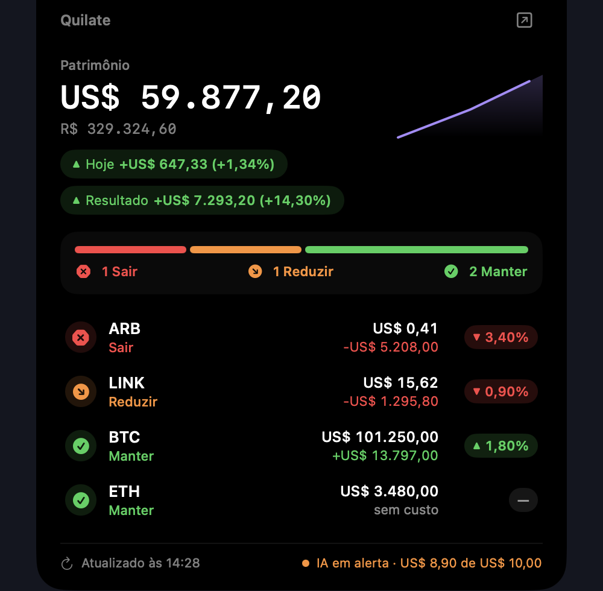

# Quilate notch app

A native macOS app that shows your crypto portfolio in the MacBook notch. It reads the local Quilate backend and only displays what it gets. It never buys or sells, and it never talks to an exchange or to Telegram.

Closed, the panel cycles through your coins every 4 s: the ticker on the left, the verdict and the 24 h change on the right. Each verdict has its own color and icon: Manter (green, ✓), Reduzir (orange, ↘), Sair (red, ✕). On hover, the panel opens with the portfolio value in USD and BRL, today's result, the total result, the count per verdict, the coin list, and a footer with the time of the last read and the AI state. On a screen without a notch it becomes a pill at the top.

| Closed | Open |
|---|---|
|  |  |

The app text is in Portuguese.

## Requirements

- macOS 15 or newer.
- Xcode or the Command Line Tools with Swift 6.
- The Quilate backend running on `127.0.0.1:8000`, or `demo.sh`. Without either, the panel shows "Quilate desligado" and tries again every 30 s.

## Build

```sh
./build.sh
open Quilate.app
```

`build.sh` builds in release mode, assembles `Quilate.app` in this folder and signs it ad hoc. An ad hoc signature runs on the Mac that built it. Another Mac needs an Apple Developer account.

Model tests (backend JSON, pt-BR formatting, color and icon per verdict):

```sh
swift test
```

## Try it with fake data

```sh
./demo.sh
```

`demo.sh` copies the files in `Tests/Fixtures/` to a temporary folder and serves them on `127.0.0.1:8000` as `/api/overview`, `/api/verdicts` and `/api/costs`. Then open `Quilate.app`. Stop with Ctrl-C: the script removes the temporary folder. If port 8000 is in use, it prints `Port 8000 is in use. Stop the Quilate backend first.` and exits with code 1.

## Use with the backend

From the repository root:

```sh
cd backend && uv run quilate servir
```

The app reads `GET /api/overview` and `GET /api/verdicts` every 30 s, and `GET /api/costs` every 5 min. No secret goes through the app. The local API has no access code yet: see "Known gap" in [docs/threat-model.md](../docs/threat-model.md).

## Open at login

1. Open System Settings, General, Login Items & Extensions.
2. Under "Open at Login", click + and choose `Quilate.app`.

The backend must also be running at login (`ops/instalar-launchd.sh`, see [docs/install.md](../docs/install.md)). If it starts later, the panel recovers by itself on the next read.

## Menu

Right-click the panel. "Abrir dashboard" opens `http://127.0.0.1:8000` in the browser. "Sair" quits the app.
